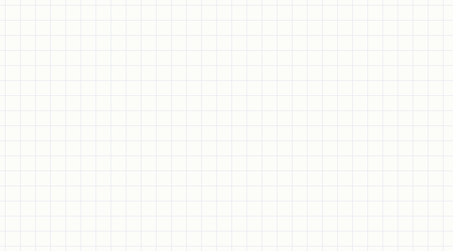

# Hi, I'm Edinilson Santos Silva Filho 👋

I'm a **Full-Stack Developer in training**, currently pursuing a **Technical High School Program in Informatics** at the **Federal Institute of Mato Grosso do Sul (IFMS)**.

I enjoy building web applications from end to end, with a particular interest in **Back-End development, APIs, database design, and application architecture**.

My main stack revolves around **TypeScript, Node.js, React, Next.js, PostgreSQL, Prisma, and Supabase**, while I continuously explore new tools and concepts to improve the way I build software.

---

## ⚡ Tech Stack

### Front-End

### Back-End

### Databases & ORM

### Languages

### Tools

---

## 🎯 What I'm Focused On

* Building **REST APIs** and scalable Back-End applications
* Designing and working with **relational databases**
* Improving my knowledge of **Node.js, Express.js, and NestJS**
* Deepening my understanding of **PostgreSQL, Prisma, and Supabase**
* Exploring software architecture and better development practices
* Building complete **full-stack applications** with React and Next.js

---

## 🎓 Education

**Technical High School Program in Informatics**
**Federal Institute of Mato Grosso do Sul — IFMS**

---

## 📊 GitHub Stats

 

---

## 🧠 A Bit About Me

I'm interested in understanding not only **how to make software work**, but also how to structure it in a way that is maintainable, efficient, and reliable.

Although I work across the entire stack, I'm especially interested in what happens behind the interface: **business logic, APIs, data modeling, databases, and Back-End architecture**.

I'm always learning, experimenting, and improving one project at a time.

---

*"Estamos apenas vagando através da tundra de nossa existência, atribuindo valor ao inútil, quando tudo que amamos e odiamos, tudo em que acreditamos e pelo que lutamos, matamos e morremos, é tão sem sentido quanto imagens projetadas sobre o acrílico."*

**Blake Crouch —** ***Matéria Escura (Dark Matter)***

